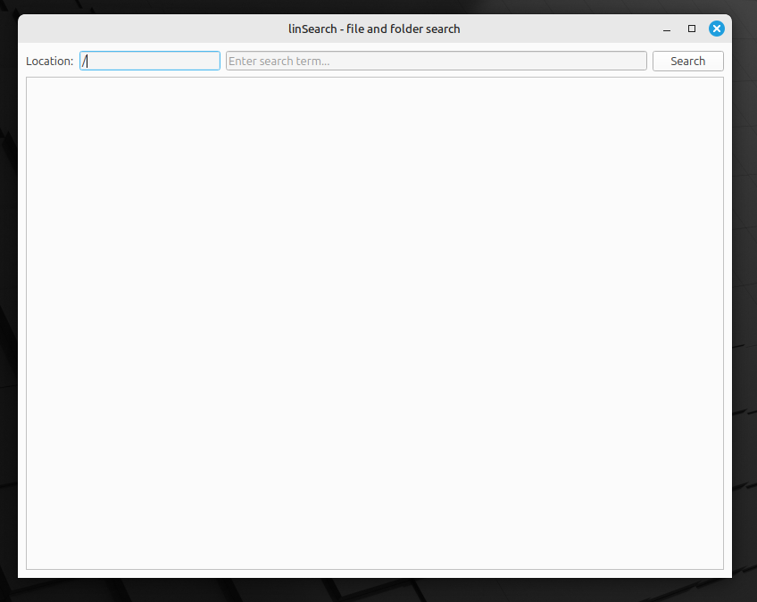

# linSearch
linSearch is a python app for `find`, a GNU coreutil. this app allows you to search your files and folders on your linux PC.

# how to use
there are two ways you can use this python app:
- use the python script.
- use the program.

## using the python script
simply double-click the `launcher.sh` file. if that doesn't work, you have to right-click the script --> click "properties" --> click the "Permissions" tab --> and then click "allow executing file as program."

alternatively, you can just open your terminal and run this command: `chmod +x path_to_launcher.sh`

when you launch the script, the script will create the `venv` environment and install the necessary pip packages.

## using the executable
the steps are similar on using the script, although `venv` environment and this script's packages won't be installed since it's an executable.

# compiling
if you want to compile this script into exe, you can use [pyinstaller](https://pypi.org/project/pyinstaller/) or [nuitka](https://pypi.org/project/Nuitka/).<br>
for nuitka, use this command:
```bash
python -m nuitka \
    --mode=standalone \
    --enable-plugin=pyside6 \
    linSearch.py
```
note: make sure you enter `venv` first and install nuitka. you can do that by going to the root directory of the project and run `source venv/bin/activate` and then install nuitka (if you haven't) by running `pip install Nuitka`

# screenshot
